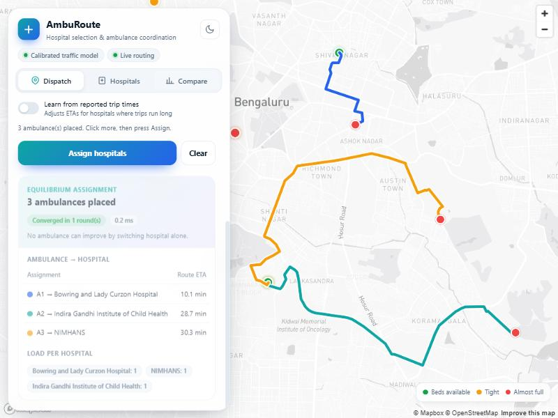
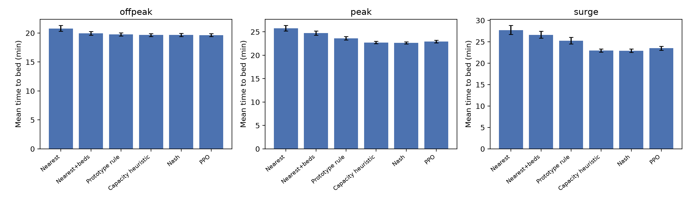
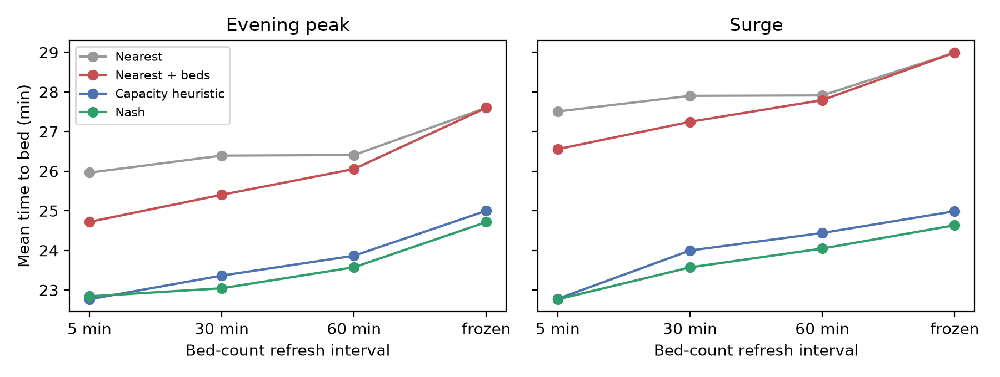
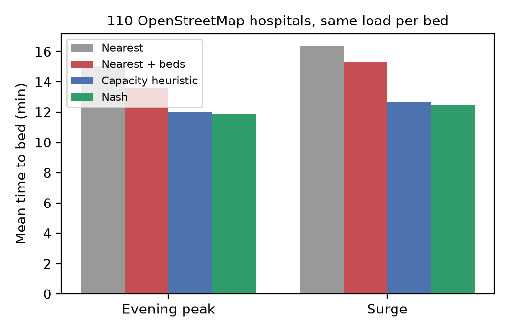
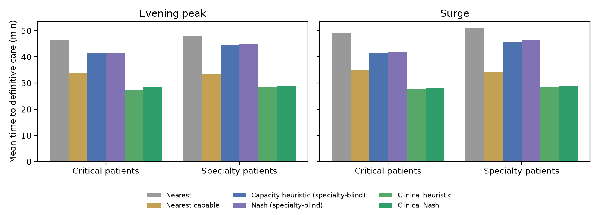
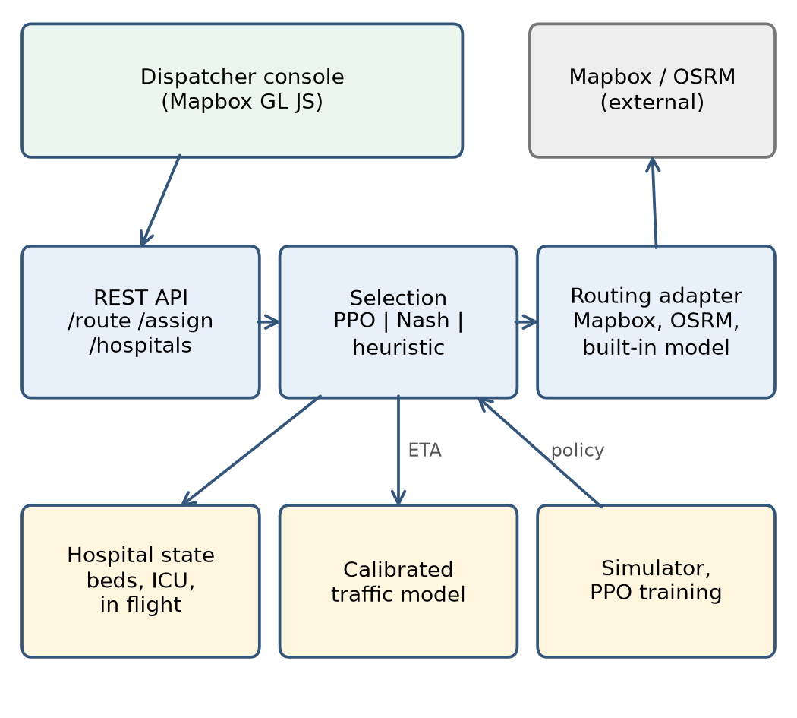
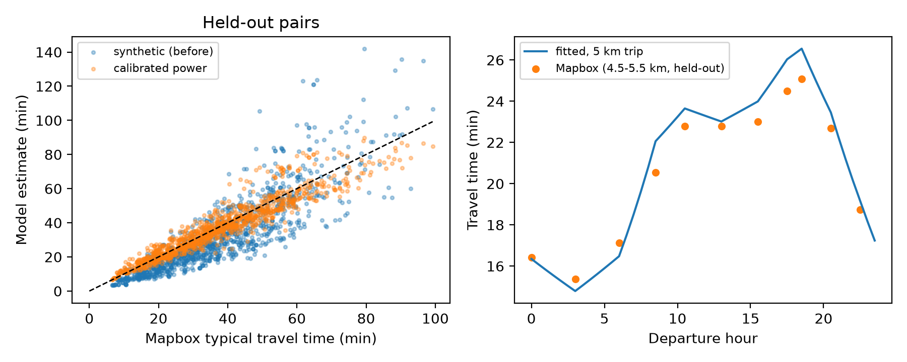
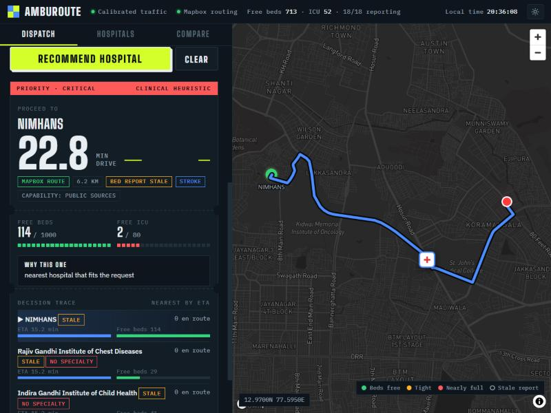
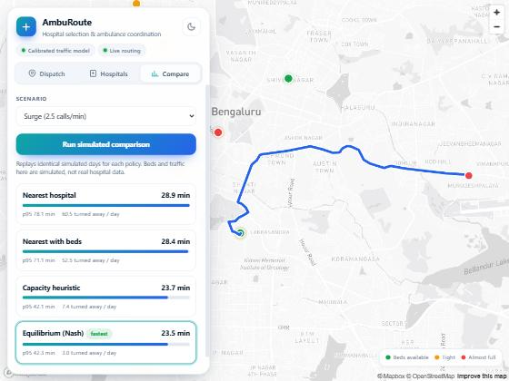

<div align="center">

# 🚑 AmbuRoute

### Pick the right hospital, not just the nearest one.

Traffic-aware ambulance dispatch that counts the ambulances **already on the road**, with a live map console, a REST API and a fully reproducible evaluation.


[](https://github.com/Kushal-Raj-G-S/AMBUROUTE/actions)




<sub>Four ambulances assigned at an equilibrium, with live-traffic Mapbox routes.</sub>

</div>

---

## 📌 The idea in 30 seconds

When an ambulance leaves with a patient, the crew must choose **which hospital** and **which road**.

The catch: a hospital's published bed count is refreshed only every few minutes and it **never includes ambulances already heading there**. So several crews who each pick "the nearest hospital with a free bed" can arrive together, get turned away at the door and lose precious minutes. We call this **herding**.

AmbuRoute models the problem in a simulator of Bengaluru (18 hospitals, travel times fitted to real Mapbox traffic data) and compares simple rules, an equilibrium-based assignment and a reinforcement-learning policy.

## 🏆 Results at a glance

Mean over **50 held-out random days per scenario**. Every method was tuned on separate validation days first and tested **once**. Lower is better.

| Scenario | Nearest hospital | Capacity-aware heuristic | **Nash assignment** | PPO (RL) |
|---|---:|---:|---:|---:|
| Evening peak, minutes to a bed | 25.78 | 22.73 | **22.64** | 22.94 |
| Evening peak, turn-aways per day | 30.1 | 3.5 | **2.8** | 5.5 |
| Surge, minutes to a bed | 27.75 | 22.97 | **22.91** | 23.50 |
| Surge, turn-aways per day | 46.8 | 6.2 | **5.6** | 11.1 |

- ✅ Counting ambulances already on the way cuts time-to-bed by **12 % (evening peak) and 17 % (surge)** and removes **87-93 %** of turn-aways.
- ✅ The Nash assignment is as fast as the tuned heuristic with **10-20 % fewer rejections**, and it provably converges (it did in all 4,239 test batches).
- ⚠️ The PPO policy **matched but did not beat** the tuned heuristic. We report that as it is.

<div align="center">

</div>

## 🔭 Beyond the paper

Three extension studies and a pilot plan, all in [`docs/`](docs/):

<table>
<tr>
<td width="50%"><br><sub><b>Old bed data</b> erodes the gain but does not remove it; the Nash edge grows as data ages.</sub></td>
<td width="50%"><br><sub><b>City scale</b> (110 real OpenStreetMap hospitals, assumed beds): time to bed improves 21-24 % when load per bed is tight.</sub></td>
</tr>
</table>

<div align="center">
<br>
<sub><b>Severity and specialty</b> (assumed inputs): time to definitive care for critical and specialty patients.</sub>
</div>

| Document | What it covers |
|---|---|
| [`docs/market_research.md`](docs/market_research.md) | Sourced evidence that the problem is real in Bengaluru, how bed data is reported today, competitors, regulatory notes |
| [`docs/extension_results.md`](docs/extension_results.md) | Stale bed data up to "frozen", and a 110-hospital city-scale stress test |
| [`docs/clinical_extension.md`](docs/clinical_extension.md) | **Severity and specialty** (cardiac, stroke, trauma): critical patients reach definitive care **32-34 % faster** than with specialty-blind policies and **16-19 % faster** than "nearest capable hospital" (all clinical inputs assumed) |
| [`docs/pilot_design.md`](docs/pilot_design.md) | Shadow-mode pilot, metrics, sample-size estimate (3-15 matched days to beat "nearest hospital"), safety and privacy |

> Takeaway for a product: ship the simple, explainable capacity heuristic first; its value concentrates where hospital capacity is tight and where bed reports are fresh.

## 🧭 How it works

<div align="center">

</div>

1. **Filter** hospitals that have a free bed of the needed type (general or ICU).
2. **Estimate** travel time to each candidate with a model fitted to real Mapbox typical-traffic data.
3. **Select** a hospital: PPO if a model is loaded, otherwise the equilibrium solver or the capacity heuristic.
4. **Coordinate** several ambulances at once: they take turns switching hospital until nobody can improve alone (a congestion game with a potential function, so it always stops).
5. **Route** with Mapbox live traffic, falling back to OSRM and then to the built-in model.

### Traffic model, checked against real data

Travel times are fitted to **3,861 Mapbox typical-traffic samples** and scored on **105 routes the model never saw**: error **11.3 %** (25.8 % before calibration).

<div align="center">

</div>

## 🖥️ The console

<table>
<tr>
<td align="center" width="33%"><br><sub><b>Single dispatch</b><br>recommended hospital, ETA and live-traffic route</sub></td>
<td align="center" width="33%"><br><sub><b>Several ambulances</b><br>equilibrium assignment, converged in one round</sub></td>
<td align="center" width="33%"><br><sub><b>Compare</b><br>simulated days, every policy side by side</sub></td>
</tr>
</table>

- Click the map to place an incident, tick **ICU** if needed and press **Recommend hospital**.
- The **Hospitals** tab lets a hospital update its own bed counts (`POST /hospitals/{id}/beds`).

## 🚀 Quick start

```bash
git clone https://github.com/Kushal-Raj-G-S/AMBUROUTE.git
cd AMBUROUTE
python -m venv .venv
# Windows:  .venv\Scripts\activate        macOS / Linux:  source .venv/bin/activate
pip install -r requirements.txt
cp .env.example .env          # then paste your free Mapbox token into .env
python -m uvicorn amburoute.api:app --reload
```

Open **http://127.0.0.1:8000** for the console, or **http://127.0.0.1:8000/docs** for the interactive API docs.

> You need a free [Mapbox](https://www.mapbox.com) **public** token (starts with `pk.`) for the map and live routes. Without one the API still runs and falls back to the built-in travel-time model.
> PyTorch: if `pip` picks a large CUDA build, install the CPU one first: `pip install torch --index-url https://download.pytorch.org/whl/cpu`.

## 🔌 API

| Method | Path | What it does |
|---|---|---|
| GET | `/health` | status, number of hospitals, whether a PPO model is loaded |
| GET | `/hospitals` | list hospitals with beds and ICU beds |
| POST | `/hospitals/{id}/beds` | update free beds |
| POST | `/hospitals/simulate-updates` | random-walk the bed counts (demo) |
| POST | `/route` | recommend a hospital (capacity heuristic) and return the route |
| POST | `/route/drl` | same with the PPO policy (falls back to the equilibrium solver) |
| POST | `/assign` | assign several ambulances at a Nash equilibrium |
| POST | `/route/path` | traffic-aware route to a chosen hospital |
| GET | `/compare` | simulated policy comparison |

```bash
curl -X POST http://127.0.0.1:8000/route -H "Content-Type: application/json" \
     -d '{"ambulance": {"lat": 12.97, "lon": 77.59}, "needs_icu": false}'
```

## 🔬 Reproduce the results

```bash
python -m pytest tests -q                              # 7 tests
python experiments/collect_mapbox_traffic.py 0 1       # real traffic samples (needs your MAPBOX_TOKEN, ~40 min)
python experiments/calibrate_traffic.py                # fit + validate the travel-time model
python experiments/tune_baselines.py                   # tune heuristic and Nash on validation seeds
python -m amburoute.train_ppo --tag B --seed 0 --steps 1000000 --k 12 --herding 0.3 \
       --bc 150 --lr 1e-4 --clip 0.1 --ent 0.005 --calibrated      # repeat for seeds 1 and 2
python experiments/validate_ppo.py                     # choose the PPO seed on validation seeds
python experiments/run_benchmark.py                    # the one-shot test on held-out seeds
python experiments/run_ablations.py                    # stale beds, outage, speed-up, noise
python experiments/run_staleness_tests.py              # paired tests for the staleness study
python experiments/run_ppo_vs_prototype.py             # PPO against the old prototype rule
python experiments/make_paper_assets.py                # tables and figures for the paper
```

Seeds are split into disjoint sets: training (>= 100000), validation (500-529), test (1000-1049).

> **About PPO.** Neural-network training is not bit-for-bit repeatable, so retraining gives slightly different policies (validation 21.8-22.1 min across seeds). The reported numbers use the weights shipped in `results/models/`. Everything else (simulator, heuristics, Nash, tuning, ablations) reproduces exactly.

## 🧪 What is real and what is simulated

| Item | Status |
|---|---|
| Hospital names, coordinates, bed totals | Real table (3 missing counts imputed, 2 non-emergency hospitals removed) |
| ICU beds | **Synthetic** (8 % of beds) |
| Bed occupancy over time | **Simulated** |
| Ambulance calls | **Simulated** (Poisson, uniform over the city) |
| Travel times | **Calibrated** to Mapbox typical traffic |
| Ambulance speed-up over cars | **Assumed** (1.25, varied in the sensitivity study) |

Results compare policies under these assumptions. They are **not** predictions of real response times.

## 🗂️ Project layout

```
amburoute/            core package: simulator, policies, Nash solver, PPO environment, API
  web/index.html      dispatcher console (Mapbox GL JS)
experiments/          calibration, tuning, benchmark, ablations, table and figure generation
tests/                unit and API tests
data/                 hospital table
results/              result tables, figures, fitted traffic parameters, trained PPO weights
paper/                LaTeX source and figures
docs/                 market research, extension results, pilot design; images/ holds README images
Dockerfile            run the API in a container (pass MAPBOX_TOKEN at run time)
.github/workflows/    continuous integration: runs the tests on every push
```

## ⚠️ Limitations

Bed counts, ICU capacity and calls are simulated; travel times follow typical (not live) traffic; time-to-bed is a stand-in for clinical outcome; triage and specialty capability are not modelled; one city only. Automated recommendations should support, not replace, a dispatcher, and need a field study before any real use.

## 📄 License

Released under the [MIT License](LICENSE).

## 📝 Notes

- The raw Mapbox responses are **not** included. `collect_mapbox_traffic.py` regenerates them with your own token, and `results/traffic_calibration.json` holds the fitted parameters. Please respect Mapbox's terms of service.
- Hospital locations in `data/osm_*` come from OpenStreetMap, © OpenStreetMap contributors, available under the [ODbL](https://www.openstreetmap.org/copyright). Bed counts for those hospitals are **assumed**.
- Never commit `.env`. It is listed in `.gitignore`.
- The hospital table comes from the project's first prototype; its original source still needs to be cited.
