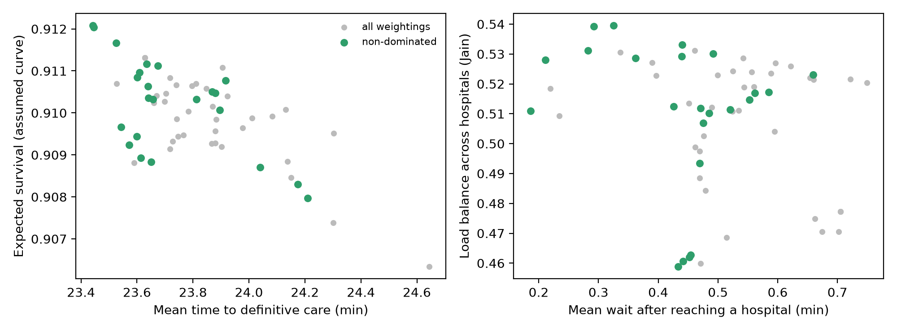
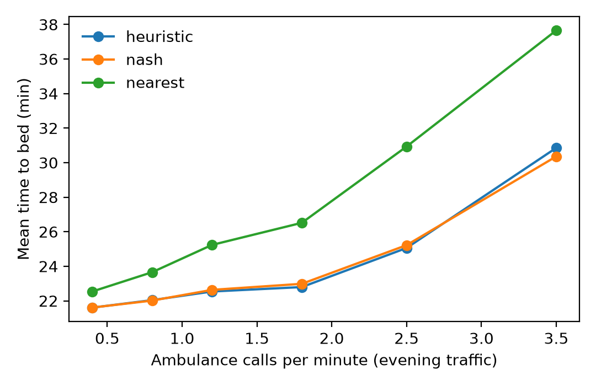
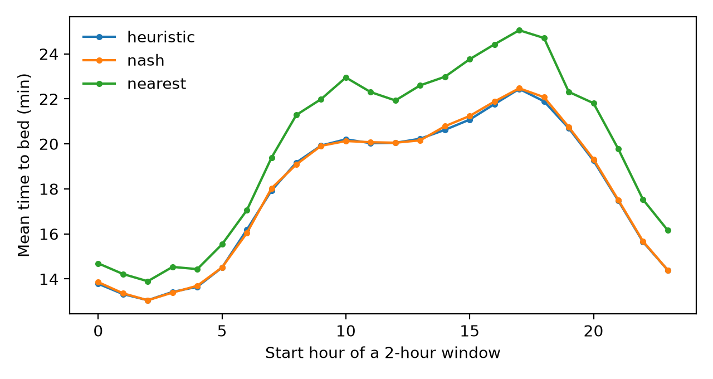

# Additional studies: modules, objectives, online adaptation, learned costs, real-data checks

*All runs use the paper's simulator, travel-time model and tuned parameters. Test seeds 1000-1049 (30 for the clinical and multi-objective studies); weights and scales are chosen on validation seeds 500-529 only. Tests are paired Wilcoxon with Bonferroni correction. Every table is produced by the script named in its heading; raw numbers are in `results/`.*

## 1. What does each module contribute? (`experiments/run_module_ablation.py`)

Full system = calibrated travel times + in-flight load + congestion game. Each row removes one module; nothing is re-tuned.

| Variant | Peak: min to bed | vs full | Peak rejections | Surge: min to bed | vs full | Surge rejections |
|---|---:|---:|---:|---:|---:|---:|
| Full system | 22.64 | | 2.8 | 22.91 | | 5.6 |
| No congestion game (heuristic instead) | 22.73 | +0.4 % (n.s.) | 3.5 | 22.97 | +0.3 % (n.s.) | 6.2 |
| No traffic calibration | 22.84 | +0.9 % (n.s.) | 3.8 | 23.20 | +1.3 % (p = 0.004) | 8.3 |
| **No in-flight load** | **23.69** | **+4.6 % (p < 0.001)** | 11.3 | **25.17** | **+9.9 % (p < 0.001)** | 24.2 |
| None of the three (nearest hospital) | 25.78 | +13.9 % | 30.1 | 27.75 | +21.1 % | 46.8 |

Counting ambulances already on the road is the module that matters. Calibration helps a little, mostly under surge. The game adds almost nothing in minutes and a little in rejections.

**PPO warm start** (`experiments/run_ppo_warmstart.py`, 1M steps, three seeds per variant, seed chosen on validation):

| PPO variant | Peak | Surge | Peak rejections | Surge rejections |
|---|---:|---:|---:|---:|
| With behaviour-cloning warm start (chosen seed) | 22.94 | 23.50 | 5.5 | 11.1 |
| Without warm start (chosen seed) | 24.36 | 25.76 | 18.4 | 29.7 |
| Tuned heuristic | 22.73 | 22.97 | 3.5 | 6.2 |

Without imitation the learner is 6 % (peak) and 10 % (surge) slower than with it, and its three seeds spread widely (peak 24.4 to 25.8). Warm-started PPO is within 0.9 % of the heuristic at peak (not significant after correction) and 2.3 % slower in the surge.

## 2. Several objectives at once (`experiments/run_multiobjective.py`)

Objectives: mean time to definitive care, expected survival, wait after reaching a hospital, load balance across hospitals (Jain). **The survival curve is assumed** (`exp(-hazard * t)`, hazards 0.05 / 0.25 / 0.90 per hour for stable / urgent / critical). 60 weightings (door-wait weight, severity scaling, crowding penalty) were scored on validation seeds and the non-dominated set found.

Result on 30 test seeds (peak): the goals mostly point the same way. The balanced operating point picked on validation is exactly the clinical heuristic of `clinical_extension.md`; the "fastest" point saves 0.15 min of mean time by accepting 4x more waiting at the door (0.35 vs 0.08 min) and 4x more rejections. Expected survival moves only between 0.913 and 0.915 because the assumed curve is gentle. **There is no sharp trade-off here**, and the survival numbers should not be read as clinical.

## 3. Online adaptation to local traffic jams (`experiments/run_online.py`)

Drift: from minute 30, trips to four randomly chosen hospitals take twice as long as the fitted model says. `OnlineETA` learns a per-hospital correction from en-route progress reports (assumed to be available 35 % into each trip) and applies only relative corrections.

| Mean minutes to bed (heuristic base) | Fixed model | Online | Oracle (knows the jams) |
|---|---:|---:|---:|
| Local jams, peak | 26.21 | **24.58 (-6.2 %)** | 23.42 (-10.6 %) |
| Local jams, surge | 25.44 | **24.79 (-2.6 %)** | 23.46 (-7.8 %) |
| No drift, peak | 22.73 | 22.86 (+0.6 %, n.s.) | 22.73 |
| Citywide slowdown x1.5, peak | 30.88 | 31.39 (+1.6 %, p = 0.002) | 30.97 |

The learner recovers about 60 % of the possible gain at peak and about a third in the surge, and costs up to 2 % when the whole city slows evenly (its corrections are then noise). **A first version that learned only from finished trips gave no gain**: observations arrive too late and too rarely, because few ambulances go to any one hospital. The same holds for the equilibrium base policy.

## 4. Learned congestion cost with a graph network (`experiments/run_gnn.py`)

A two-layer graph network over a hospital nearest-neighbour graph predicts the minutes a patient will lose at the door at each hospital, trained on 77,407 exploratory dispatches (training seeds only), replacing the hand-set `w / (1 + beds)` term. The cost scale was chosen on validation seeds (6.0 for the graph network, 3.0 without edges; 6.0 is the top of the search grid).

| Mean minutes to bed | Off-peak | Peak | Surge |
|---|---:|---:|---:|
| Nearest | 20.79 | 25.78 | 27.75 |
| Tuned heuristic | 19.66 | 22.73 | 22.97 |
| Tuned Nash | 19.67 | 22.64 | 22.91 |
| **Graph network** | 19.67 | 22.59 | 22.90 |
| Same network without edges | 19.68 | 22.59 | 22.88 |

The graph network matches the tuned heuristic and Nash assignment (all differences are small and none is significant after correction), **without any hand-set congestion weight**. The edges add nothing measurable on this 18-hospital map. It is about 20x slower per decision (0.24 ms vs 0.01 ms), which is immaterial. The honest reading: a learned cost is a viable replacement for the hand-crafted one, but not an improvement.

## 5. Checks against real data (`experiments/real_data_nyc_ems.py`, `run_clinical_realmix.py`)

No call-level EMS or hospital-bed data for Bengaluru is public (a CAG audit report covers Karnataka's 108 service only in aggregate). We used the public NYC "EMS Incident Dispatch Data" (NYC Open Data, 2023; aggregates in `data/real_nyc_ems_*`) to check two assumptions:

- **Demand is flat in the afternoon and evening** (17-19h vs 12-14h ratio 1.01). The paper's "evening peak" (1.2 vs 0.5 calls per minute) is therefore a **stress scenario**, not a measured demand spike; traffic and bed occupancy, not call volume, make the evening hard.
- **Real dispatch priority mix** is 22 % highest priority (levels 1-2), 35 % (3-4), 43 % (5+), against our assumed 15 / 30 / 55 split (priority codes are not clinical triage, so this is a proxy). Re-running the clinical study with this mix and unchanged policies: clinical Nash reaches critical patients 23 % faster than nearest-capable at peak and 21 % faster in the surge, and 28 % / 26 % faster than the specialty-blind Nash (all p < 0.001; Nash is again not distinguishable from the clinical heuristic). The conclusion survives a more severe mix.

## Limits

The traffic-drift, survival and GPS-progress assumptions are ours; beds, ICU capacity, calls and hospital capabilities remain simulated. NYC is a different city and system. Several comparisons are not significant and are reported as such.

## 6. Stress tests (`experiments/run_stress.py`)

**Call-rate sweep** (evening traffic, 30 seeds, paper's tuned policies, mean minutes to bed):

| Calls per minute | 0.4 | 0.8 | 1.2 | 1.8 | 2.5 | 3.5 |
|---|---:|---:|---:|---:|---:|---:|
| Nearest hospital | 22.54 | 23.66 | 25.24 | 26.52 | 30.93 | 37.66 |
| Tuned heuristic | 21.61 | 22.04 | 22.54 | 22.80 | 25.06 | 30.86 |
| Tuned Nash | 21.61 | 22.01 | 22.63 | 22.98 | 25.22 | 30.36 |

The value of capacity awareness grows with load: 4 % at 0.4 calls per minute, 18 % at 3.5. The heuristic and Nash stay within about 1 % of each other except at the heaviest load, where Nash is 1.6 % lower (not tested for significance in this sweep).

**Everything wrong at once** (clinical mode, bed reports every 15 minutes, local traffic jams at four hospitals, policies not re-tuned; critical patients, minutes to definitive care, 30 seeds):

| | Peak | Surge |
|---|---:|---:|
| Nearest capable | 38.40 | 38.23 |
| Clinical heuristic | 31.67 | 31.55 |
| Clinical Nash | 32.09 | 31.69 |
| Clinical heuristic + online ETA | 31.13 | 30.40 |
| Clinical Nash + online ETA | 31.19 | 31.23 |

Even with stale bed data and jams, both clinical policies beat the strongest simple baseline by 16-18 % (all p < 0.01 after correction). The online correction adds a further 1.4-3.6 %, which is **not significant after correction** in any single comparison (smallest corrected p = 0.15): it is a small, consistent help, not a proven one.

## 7. A day in the life (`experiments/run_day_profile.py`)

Call volume follows the **shape** of the real NYC hourly profile (`data/real_nyc_ems_hourly.csv`); travel times follow the calibrated Bengaluru hourly traffic model. The mean rate (0.85 calls per minute) is an assumption. Each hour starts a 2-hour window, 30 seeds each.

Across the 24 windows the tuned heuristic is **9.4 % faster than nearest-hospital dispatch on average** and 10.4 % faster in the worst window for nearest (start 17:00). With the heuristic, time to bed runs from about 13 min in the small hours to about 22 min at 17:00 (nearest hospital: about 14 to 25 min); the benefit of capacity awareness tracks the traffic and call profile rather than the clock alone.

## 8. Realistic call locations (`experiments/fetch_density_mapbox.py`, `run_spatial_demand.py`)

The paper's simulator draws call locations uniformly over the map, which is unrealistic. Here calls follow the **number of building footprints per map tile** (Mapbox vector tiles at zoom 15, 462 tiles binned into a 10 x 10 grid; counts range from 520 to 7,842 per cell). Buildings are a coarse proxy for population, not a measurement of where calls occur, and only the aggregated counts are stored. Policies are the paper's tuned ones, **not re-tuned**; PPO was trained on uniform calls, so this also tests it out of distribution. 50 test seeds.

| Mean minutes to bed | Peak: uniform | Peak: density | Surge: uniform | Surge: density |
|---|---:|---:|---:|---:|
| Nearest | 25.78 | 22.31 | 27.75 | 23.52 |
| Heuristic | 22.73 | 20.03 | 22.97 | 20.40 |
| Nash | 22.64 | 19.97 | 22.91 | 20.54 |
| PPO (trained on uniform calls) | 22.94 | 20.09 | 23.50 | 20.73 |

- All times fall because calls now concentrate near the centre, where the hospitals are.
- Capacity awareness still helps significantly, **but less than with uniform calls: -10 % at peak (was -12 %) and -13 % in the surge (was -17 %)**. The uniform assumption overstated the benefit by roughly 2-4 percentage points.
- Nash and the heuristic remain indistinguishable (differences under 1 %, not significant). PPO matches the heuristic at peak (+0.3 %) and is 1.6 % slower in the surge (corrected p = 0.09), so it carries over to a different demand pattern without retraining.

## 9. Real arrival times (`experiments/run_nyc_replay.py`)

The simulator draws calls from a Poisson process. To test that, the 17:00-19:00 call times of ten NYC weekday evenings (2023-03-06 to 03-17, public NYC EMS dispatch log, times only in `data/real_nyc_ems_evening_calls.csv`) were replayed, thinned at random to the paper's peak rate (1.2 calls per minute; five random thinnings per evening), on the Bengaluru simulator with the tuned, un-retuned policies.

- **Poisson is a fair description of arrivals at this scale.** The variance-to-mean ratio of 2-minute call counts is **0.92** (Poisson = 1), i.e. no extra burstiness. (Thinning would hide some burstiness; this is measured on the unthinned counts.)
- **The conclusions hold on real arrival times:** minutes to bed 26.56 (nearest), 22.78 (heuristic), 22.82 (Nash); heuristic **-14.2 %** and Nash **-14.1 %** against nearest (p < 0.001), Nash vs heuristic +0.2 % (not significant). Rejections: 32.9, 2.8, 2.7.
- Real arrivals are slightly *more regular* than Poisson, so the replay shows somewhat fewer rejections than the Poisson runs on the same seeds (2.8 vs 4.4 for the heuristic).

Limits: NYC call times in a Bengaluru simulator; the mapping is only for the timing pattern.

## 10. Capabilities from public sources instead of assumptions (`data/hospital_capabilities_researched.csv`, `run_clinical_researched.py`)

The clinical study had assigned cardiac, stroke and trauma capability to hospitals by size, and the assignment was visibly wrong for well-known hospitals (a cardiac institute was marked "no cardiac"). Public sources were searched for each of the 18 hospitals, and a service is counted **only if a public source states it** (evidence and URLs are in the CSV). Result: **cardiac 4, stroke 3, trauma 4 of 18 hospitals** (Jayadeva, Manipal Old Airport Road, Aster RV and KC General for cardiac; NIMHANS, St. Martha's and Aster RV for stroke; Victoria, HOSMAT, Aster RV and Fortis for trauma). Treat this as a **lower bound**: services without a findable public source are counted as absent.

Evidence quality is mixed: Jayadeva, NIMHANS, Victoria and KC General rest on news, reference-work or peer-reviewed sources; Manipal, Aster RV, HOSMAT and Fortis on the hospitals' own pages or sponsored profiles (self-reported); St. Martha's on a stroke-programme directory. The cited pages were then **opened and checked on 2026-10-27** (column `verification` in the CSV): Jayadeva, NIMHANS, KC General and St. Martha's are verified at the source; Manipal and HOSMAT are verified as self-reported claims; Aster RV and Fortis are only partly verified (Aster names a biplane cath lab but not primary angioplasty; the Fortis page is sponsored content and names no cath lab); **Victoria's trauma centre could not be verified** (the news page returned HTTP 403 and the only other page found is unreliable), although it is counted. Several hospitals could not be matched to a specific campus and are counted as absent.

Rerun of the clinical comparison with these capabilities and the real NYC severity mix (30 test seeds, policies not re-tuned), critical patients, minutes to definitive care:

| | Peak | Surge |
|---|---:|---:|
| Nearest | 58.8 | 61.7 |
| Nearest capable | 52.3 | 56.8 |
| Specialty-blind heuristic | 46.7 | 48.1 |
| Specialty-blind Nash | 47.3 | 47.7 |
| **Clinical heuristic** | **40.7** | 45.7 |
| **Clinical Nash** | 40.9 | **44.9** |

- With realistic scarcity everything is slower (critical patients wait 41-46 min against 28-32 min under the assumed capabilities), because only three or four hospitals can treat each specialty.
- The clinical policies still beat the strongest simple baseline, nearest capable hospital, by **about 21-22 %** (corrected p between 0.0004 and 0.011), and about 78 % of specialty patients treated by the specialty-blind policies still need a transfer.
- Against the specialty-blind equilibrium the clinical Nash is 14 % faster at peak (corrected p = 0.09) and 6 % in the surge (not significant), a weaker result than with assumed capabilities.
- **Capable hospitals saturate**: rejections rise to 15-22 per episode for the clinical policies (4-8 per episode for specialty-blind ones), because patients concentrate on the few capable hospitals. This is the main practical finding: where specialty capacity is this scarce, the limit is capacity at those hospitals, not dispatch logic.

**Re-tuned on the researched capabilities** (`experiments/tune_clinical_researched.py`, then `run_clinical_researched.py`; weights chosen on validation seeds only, test seeds used once). The table above used parameters tuned for the *assumed* capabilities; re-tuning gives clinical heuristic weight 320 and clinical Nash beta 80, power 1. **The heuristic's best weight is again at the top of its search grid (10-320), so the true optimum may be higher.**

| Critical patients, minutes to definitive care | Peak | Surge | Rejections (peak / surge) |
|---|---:|---:|---:|
| Nearest capable | 52.3 | 56.8 | 41.6 / 51.3 |
| Specialty-blind heuristic | 46.7 | 48.1 | 4.2 / 7.3 |
| Specialty-blind Nash | 47.3 | 47.7 | 4.1 / 8.4 |
| Clinical heuristic (not re-tuned) | 40.7 | 45.7 | 15.8 / 22.3 |
| Clinical Nash (not re-tuned) | 40.9 | 44.9 | 15.0 / 21.5 |
| **Clinical heuristic (re-tuned)** | **38.9** | **41.7** | 10.0 / 15.3 |
| **Clinical Nash (re-tuned)** | 39.8 | 44.3 | 12.0 / 19.8 |

- Re-tuned clinical policies beat nearest capable by **24-27 %** (corrected p <= 0.004) and the specialty-blind heuristic by **17 % at peak and 13 % in the surge** (corrected p = 0.02 and 0.045).
- Clinical Nash against the specialty-blind Nash: 16 % at peak (corrected p = 0.075) and 7 % in the surge (not significant).
- Re-tuning improved the heuristic by 4 % (peak) and 9 % (surge) and cut its rejections by about a third, but neither difference is significant after correction.
- Nash and the heuristic are again statistically indistinguishable (Nash 2 % and 6 % slower, p > 0.1). With this few capable hospitals, **the simple heuristic is the safer choice**.

## 11. Measured hospital capacity instead of assumed (`experiments/fetch_hhs_capacity.py`, `run_real_capacity.py`)

The paper's simulator gives every hospital 88-99 % general-bed occupancy, which leaves about 6.5 % of beds free on average. Real hospitals look different. From 14,202 hospital-weeks of US federal facility-level data (HHS, six weeks across 2023-2024, hospitals with at least 25 beds and 4 ICU beds), the median general-bed occupancy is 79 % (middle half 64-90 %), and for large hospitals (500 beds and above, 1,562 hospital-weeks) it is 85 % (77-92 %); ICU occupancy for large hospitals has a median of 82 %. Only the anonymous profile is kept (`data/real_capacity_profile.csv`: size, occupancy, ICU share of beds, ICU occupancy).

**The Bengaluru map and hospitals are unchanged**, with their real bed totals. For each simulated day, each hospital draws one real hospital-week of similar size from the profile (`amburoute/capacity.py`) and takes its occupancy, ICU share and ICU occupancy. Every seed draws different capacities, so no result rests on one arbitrary assignment. The profile is **US data applied to Bengaluru's hospitals**: it gives realistic variation and size effects, not Bengaluru measurements. The sampler needs only a `beds` column, so another city or state would need only its own hospital table and traffic data. On average 20 % of general beds are free under this draw, against 6.5 % in the paper's assumption.

Policy parameters: the paper's (heuristic weight 20, equilibrium beta 10, power 2) and, re-tuned on validation seeds under the new capacities, **the same values**, so the earlier tuning is not an artefact of the old assumption. PPO is run without retraining. 50 test seeds per scenario.

| Mean minutes to bed | Off-peak | Peak | Surge |
|---|---:|---:|---:|
| Nearest hospital | 19.51 | 22.67 | 22.97 |
| Capacity heuristic | 18.98 | 21.79 | 21.69 |
| Equilibrium | 18.96 | 21.72 | 21.73 |
| PPO (not retrained) | 19.04 | 21.88 | 21.86 |
| Turned away per day: nearest / heuristic | 2.0 / 0.14 | 10.2 / 0.38 | 12.3 / 0.64 |

- **The time saving is smaller than in the paper.** Capacity-aware dispatch is 2.7 % (off-peak), 3.9 % (peak) and 5.6 % (surge) faster than nearest-hospital dispatch (all significant after correction), against 5.5 %, 11.8 % and 17.2 % under the assumed capacities. **The paper's headline gains describe a tight system; with measured capacity they are roughly a third of that.**
- **The reduction in turn-aways survives:** about 93-96 % fewer ambulances turned away, because the heuristic still avoids the hospitals that are full at that moment.
- Equilibrium and heuristic differ by under 0.4 % (equilibrium slightly ahead at peak, corrected p = 0.007; no difference in the surge). PPO is 0.3-0.8 % slower than the heuristic (significant at peak and surge), which is expected since it was trained on the tight regime.
- **The benefit grows with pressure, but not in every scenario.** In the surge, the third of days with the least free capacity gains 7.3 % against 3.2 % for the third with the most. At peak the three groups gain 3.1 %, 4.9 % and 3.6 %, so there is no clean trend there.

What this means for the paper: report the benefit as conditional on capacity pressure, give both the tight (assumed) and the measured-capacity results, and say the second uses US-derived profiles.

### Provenance of the capacity profile (2023-2024 US data) and how recent it is

- **Source:** "COVID-19 Reported Patient Impact and Hospital Capacity by Facility", US Department of Health and Human Services (healthdata.gov dataset `anag-cw7u`), weekly, facility level, U.S. federal government data.
- **Why it is not newer:** the reporting requirement ended in May 2024. The latest week in the series is **21 April 2024** (checked by query on 2026-10-28). The CDC's newer automated bed-capacity programme (NHSN) is visible only to each hospital and to groups that grant access, and no public facility-level dataset from it was found.
- **Weeks used:** 2023-01-22, 2023-04-23, 2023-07-23, 2023-10-22, 2024-01-21, 2024-04-21 (one per season). Rows with at least 25 inpatient beds and at least 4 ICU beds and valid usage figures were kept: **14,202 hospital-weeks** of about 29,000. Hospital names and locations were dropped.
- **Fields kept:** week, inpatient beds, general-bed occupancy (beds used divided by beds), ICU beds as a share of inpatient beds, ICU occupancy.
- **Overall:** general-bed occupancy 5th/25th/50th/75th/95th percentiles 41 / 64 / 79 / 90 / 99 %; ICU occupancy median about 75 %; ICU beds as a share of inpatient beds 6 / 10 / 14 / 18 / 29 %. **Hospitals with 500 or more beds** (1,562 hospital-weeks): general occupancy 60 / 77 / 85 / 92 / 99 %, ICU occupancy median 82 %.
- **Stability across seasons:** the median general-bed occupancy of the six weeks stays between 77 % and 82 % (large hospitals 83-87 %), so no season changes the picture.

| Week | Hospital-weeks | Median occupancy | Median ICU occupancy | Median occupancy, 500+ beds |
|---|---:|---:|---:|---:|
| 2023-01-22 | 2,450 | 80 % | 77 % | 86 % |
| 2023-04-23 | 2,365 | 78 % | 73 % | 83 % |
| 2023-07-23 | 2,326 | 77 % | 72 % | 83 % |
| 2023-10-22 | 2,351 | 78 % | 74 % | 86 % |
| 2024-01-21 | 2,429 | 82 % | 78 % | 87 % |
| 2024-04-21 | 2,281 | 78 % | 73 % | 85 % |

- **Limits:** the data is two to three years old, from the US, and weekly averages. It supports realistic variation and size effects; it is not a measurement of 2026 conditions or of Indian hospitals.
- **Reproduce:** `python experiments/fetch_hhs_capacity.py` then `python experiments/run_real_capacity.py`.

## 12. Independent real traffic check for Bengaluru, and realistic jam sizes (`experiments/analyse_gmaps_traffic.py`, `run_online_realistic.py`)

**Data.** "Bangalore Traffic dataset" by Mahesh Shantaram (2026), CC BY 4.0, https://github.com/thecont1/traffic-monitor-lizard: Google Maps travel-time estimates for 13 routes of about 10 km (one of 34 km to the airport), sampled about three times an hour, day and night. **113,886 readings over 398 days (25 September 2025 to 28 October 2026).** It was not used to fit anything. The travel-time model was fitted to Mapbox typical-traffic samples; this is a second, independent real source used to check it. Only aggregates are stored (`data/real_traffic_gmaps_profile.csv`); the raw file is downloaded on demand and cached outside the repository.

**1. Does the fitted model agree with an independent real source?** Comparing the model's car time for each route's straight-line distance with Google's weekday median for each hour:

| Check | Result |
|---|---|
| Hour-of-day shape (correlation, mean over 13 routes) | **0.94** (range 0.75-0.99) |
| Level at rush hours (08-09 and 17-19), model / Google | **0.98** |
| Level at night (01-04), model / Google | 1.24: **the model is too slow at night** |
| Mean absolute error over route-hours | 20 % (best 8 % on the south and north outer rings, worst 40 % on the airport route) |

The model reproduces the daily rhythm and rush-hour levels well. It overestimates night-time and very long expressway trips (airport route 27 km straight, outside most of the calibration pairs; flyover and Hosur Road routes), which matters little for the evening scenarios in the paper but would for night dispatch. Table: `results/gmaps_validation.csv`.

**2. How big are real day-to-day slowdowns?** Each reading divided by the typical reading for the same route, weekday or weekend, and hour:

| Percentile of the ratio | 50 | 90 | 95 | 99 | 99.9 |
|---|---:|---:|---:|---:|---:|
| All hours | 1.00 | 1.14 | 1.20 | 1.39 | 1.76 |
| Weekday rush hours | 1.00 | 1.17 | 1.24 | 1.48 | |

Only **0.45 %** of readings are 1.5 times the typical time or more, and **0.04 %** reach 2 times. The log standard deviation is 0.116, below the 0.14 used for ETA noise in the simulator (so that noise is, if anything, conservative). These are estimates for 10 km routes at half-hourly sampling, so they may understate short, sudden incidents.

**3. The earlier jam study used 2x jams, far beyond what the data shows.** Rerun with sizes taken from this data (heuristic base, 50 test seeds, mean minutes to bed; `results/online_realistic.csv`):

| Case (from minute 30) | Scenario | Fixed model | Online | Oracle |
|---|---|---:|---:|---:|
| 4 hospitals 1.25x slower | peak | 23.61 | 23.44 (-0.7 %, n.s.) | 23.10 (-2.2 %) |
| | surge | 23.59 | 23.54 (-0.2 %, n.s.) | 23.25 (-1.4 %) |
| 4 hospitals 1.5x slower | peak | 24.42 | 23.84 (**-2.4 %**) | 23.26 (-4.8 %) |
| | surge | 24.20 | 23.96 (-1.0 %, n.s.) | 23.35 (-3.5 %) |
| every trip 1.24x slower | peak | 26.50 | 26.84 (**+1.3 %, worse**) | 26.68 (+0.7 %, n.s.) |
| | surge | 25.88 | 25.97 (+0.4 %, n.s.) | 25.93 (+0.2 %, n.s.) |

**Conclusion: with realistic jam sizes the online learner brings no reliable benefit.** At 1.25x even a perfect oracle gains only 1-2 %, so there is little to learn. It helps (2.4 % at peak) only when four hospitals are 1.5 times slower to reach, a case that is about 0.45 % of readings, and it slightly hurts when the whole city slows evenly. The earlier "-6.2 % under 2x jams" is a stress-test result, not a typical one. The fixed, calibrated travel-time model is the right default; online correction is worth keeping for rare large jams only.

**What the real traffic data does not give us:** actual ambulance trips (their speed-up over cars is still an assumption), day-specific hospital-approach congestion, or rain and event days labelled for replay. Older Uber Movement ward-to-ward travel times (2016-2020, Bengaluru wards, discontinued) are a possible further source; I did not confirm that the files can still be downloaded.
